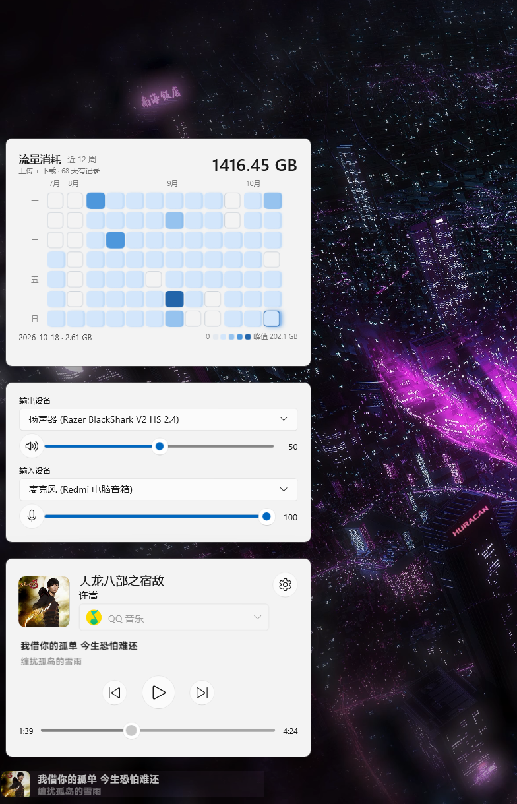
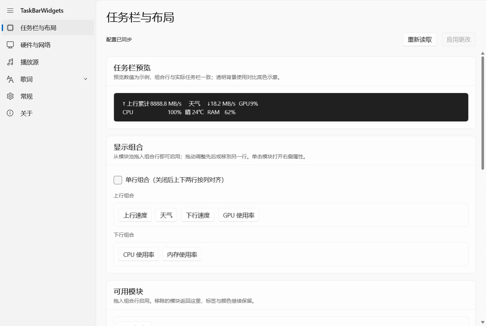
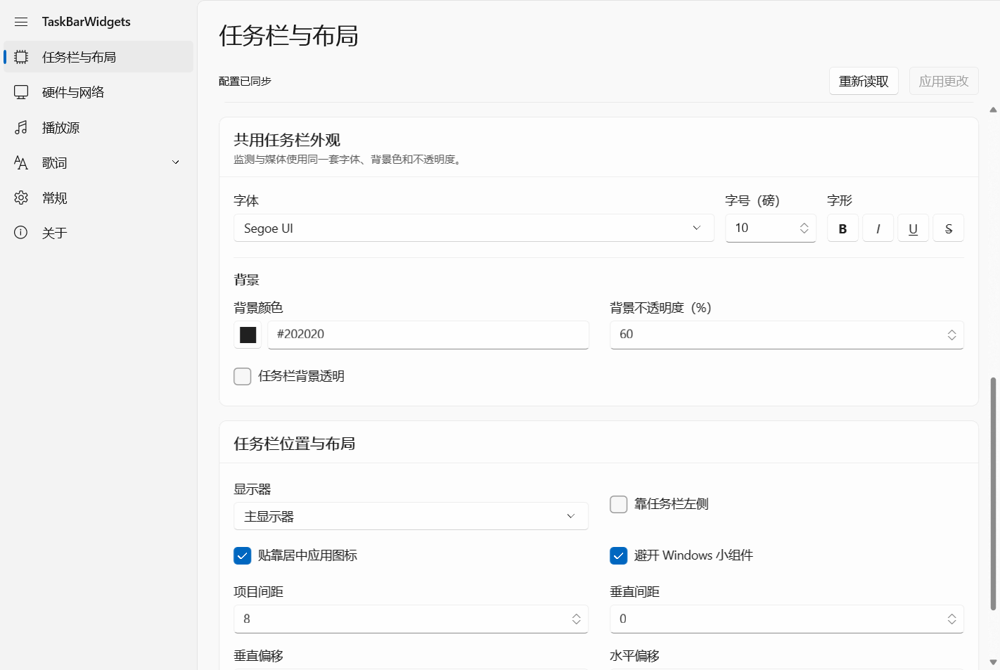
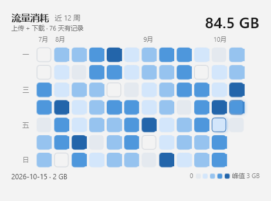
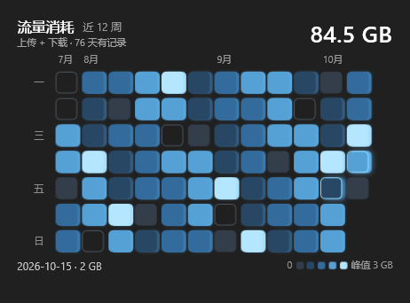

<p align="center"></p>

# TaskBarWidgets

把系统监测、歌词和音频控制放进 Windows 11 任务栏。

音乐播放时显示歌词，暂停后回到系统状态；单击打开流量、音频设备和媒体卡片。通过拖动模块，自定义任务栏显示内容和单／双行布局。

[下载最新版本](https://github.com/NoctisWang528/TaskBarWidget/releases/latest) · [使用与构建说明](TaskBarWidgets/README.md) · [验证与已知限制](TaskBarWidgets/ACCEPTANCE.md)

## 功能

- **任务栏监测**：网速、CPU、内存、GPU、温度等；电池、功耗与天气功能已内置。
- **歌词与媒体**：QQ 音乐、网易云音乐播放时显示歌词，媒体卡片同步显示当前歌词；浏览器媒体显示曲目信息与控制。来源切换支持应用图标，滚轮可临时切换显示模式。
- **可拖动布局**：模块池、单／双行组合、右侧属性抽屉和预览；双行上下共用列宽，保留对齐。
- **音频设备**：切换输入／输出设备，分别调整音量和静音；切换时同时设置默认通信设备。
- **流量日历**：最近 12 周上传与下载合计，按日流量峰值分级，支持日期详情、浅深主题和柔光。
- **WinUI 3 界面**：支持深浅主题的 Mica 设置与三张独立卡片；歌词相关设置归入一个分类。没有桌面主窗口、皮肤、外部插件管理或全局快捷键。
- **应用更新**：默认自动检查并下载正式版；下载准备好后显示可选的第四张提示卡，安装前确认并正常重启。

## 效果展示

### 卡片与任务栏实机效果



用户提供的实机截图：从上到下为流量热力图、输入输出设备和媒体卡片，底部为任务栏歌词。

以下设置页面和流量日历图片由实际 WinUI 控件离屏渲染，使用示例数据；这些示例图不是桌面实机截图，系统 Mica 和独立 Composition 柔光以实际运行效果为准。

### 任务栏布局与预览



### 字体与外观



### 流量日历

<p> </p>

## 下载与运行

1. 从 [Releases](https://github.com/NoctisWang528/TaskBarWidget/releases) 下载 `TaskBarWidgets-<版本>-win-x64.zip`。
2. 完整解压到一个可写目录，保留 `Media/`、`UI/`、`language/` 和 `licenses/` 等子目录。
3. 先退出旧版或其他占用同一任务栏区域的监测工具，再运行根目录的 `TaskBarWidgets.exe`。完整硬件监测会请求管理员权限。

较早版本需要先手动升级到包含更新器的完整发行包，并按[数据迁移说明](TaskBarWidgets/README.md#日用迁移)保留原配置与历史。此后可在“设置 → 关于”检查、下载及安装更新；“自动检查并下载更新”默认开启，修改后立即保存。下载本身不会退出程序；点击“更新并重启”并确认后才会备份、替换当前安装目录中的程序并重启。有未应用的设置或天气操作时，先回到设置处理。

准备好的更新仅在原卡片组打开时，于流量卡片上方增加一张同宽提示卡；不会自动打开卡片或发送系统通知。依赖缺失时提供官方下载入口，不自动安装共享运行库。更新失败及恢复入口见[产品更新说明](TaskBarWidgets/README.md#应用更新)。

系统要求：**Windows 11 x64**，并安装以下运行环境：

| 运行环境 | 版本与官方下载 |
| --- | --- |
| .NET Desktop Runtime | **8.0 x64**，建议安装最新安全补丁；[微软下载页](https://dotnet.microsoft.com/zh-cn/download/dotnet/8.0)中选择 **.NET Desktop Runtime → Windows → x64**。普通 .NET Runtime 不包含桌面框架，无需安装开发 SDK。 |
| Windows App Runtime（WinUI 3） | **2.5.1 x64 或兼容的更新 2.x**；[微软下载页](https://learn.microsoft.com/windows/apps/windows-app-sdk/downloads)中选择稳定版 **Installer (x64)**。安装器通常名为 WindowsAppRuntimeInstall-x64.exe。1.x 或旧 2.x 不能代替当前版本。 |
| Microsoft Edge WebView2 Runtime | 通常随 Windows 11 安装；缺失时从[微软下载页](https://developer.microsoft.com/microsoft-edge/webview2/#download)安装 Evergreen Runtime x64。 |

**261018-1408 轻量版 ZIP 约 28.8 MiB**，相对 261018-1213 的约 208.2 MiB 减少约 86.2%。界面语言资源仅保留简体中文和英文。

轻量包使用系统安装的共享 .NET 和 Windows App Runtime，不包含 `Runtime/`。Windows 自带的 .NET Framework 4.x 不能代替 .NET 8 Desktop Runtime。运行库按兼容版本共享，不必每次更新程序都重新安装。

启动前会实际检查 .NET 框架解析和 WinUI 引导；缺失、版本不匹配或加载失败时显示原因、错误代码和下载入口。只在用户点击时打开官方页面，不自动安装或改变系统设置。安装 Windows App Runtime 时请使用运行本程序的同一 Windows 账户，安装完成后重试。仍保留所需 VC/MFC 文件。不要单独运行辅助程序，也不要直接从压缩包启动。

升级到轻量版时，请按[数据迁移说明](TaskBarWidgets/README.md#日用迁移)保留配置、流量历史和媒体数据。程序移到新目录后，可在“设置 → 常规”点击“修复并启用登录启动”，更新计划任务的启动路径。

版本号采用构建时间 **`yymmdd-hhmm`**，时区为 Asia/Taipei。例如 `261016-1705` 表示 2026 年 10 月 16 日 17:05 的构建。Release 提供 ZIP、SHA-256 校验文件和应用更新元数据 `update.json`；不包含开发者配置、流量历史、日志或凭据。

| 操作 | 行为 |
| --- | --- |
| 单击任务栏窗口 | 打开／收起卡片 |
| 右键任务栏窗口 | 打开设置菜单 |
| 鼠标滚轮 | 临时切换监测／媒体模式，下次播放状态或来源变化恢复自动模式 |
| 点击卡片外部、按 Esc | 收起卡片；单纯焦点变化不会收起 |

硬件读数取决于设备和驱动；歌词与在线天气取决于外部服务。发行格式为 x64 ZIP，包内含独立原生更新器，不提供系统级安装程序或数字签名。应用内更新及桌面重启链路仍有[待验收项目](TaskBarWidgets/ACCEPTANCE.md)，配置迁移说明见[产品文档](TaskBarWidgets/README.md)。

## 从源码构建

需要 Visual Studio 2022 C++ Build Tools（MFC、C++/CLI、Windows SDK 和 .NET Framework 4.7.2 targeting pack）及 .NET 8 SDK。构建组件参照 `TaskBarWidgets/.vsconfig`。

```powershell
git clone https://github.com/NoctisWang528/TaskBarWidget.git
cd TaskBarWidget
.\TaskBarWidgets\scripts\build.ps1
```

所有产品代码与依赖声明都在 `TaskBarWidgets/`。仓库不再包含三个完整上游项目，构建不需要它们。本地输出、配置、依赖缓存和只读参考副本均不跟踪。脚本默认不启动应用。

- [界面规范](TaskBarWidgets/docs/界面统一方案.md)
- [进程通信协议](TaskBarWidgets/IPC.md)
- [开发规范](AGENTS.md)

## 许可证

本项目沿用 TrafficMonitor 的 **Anti 996 License 1.0**，见 [LICENSE](LICENSE)。第三方组件继续适用各自许可证，不因整合而变更；完整来源与授权文本见 [THIRD-PARTY-NOTICES.md](TaskBarWidgets/THIRD-PARTY-NOTICES.md)。图标通过 ChatGPT 图像生成工具制作，提示词与资产说明见 [assets/README.md](TaskBarWidgets/assets/README.md)。

## 致谢与代码来源

**本项目使用了 TrafficMonitor、TaskbarLyrics、AF-Media-Bar 这三个项目的部分代码。**

- [TrafficMonitor](https://github.com/zhongyang219/TrafficMonitor)：任务栏窗口、系统／硬件监测及可定制布局。
- [TaskbarLyrics](https://github.com/ANYNC/TaskbarLyrics)：歌词获取、解析与呈现，以及媒体会话功能。
- [AF-Media-Bar](https://github.com/Fervent-Tempo/AF-Media-Bar)：音频设备切换相关实现。

同时感谢内置电池、功耗、天气模块及其他依赖的作者；流量热力图的视觉与相对峰值分级参考了 [token-monitor](https://github.com/Javis603/token-monitor)。保留原作者署名与许可证。本项目是独立整合项目，不代表上游作者提供维护或背书。
