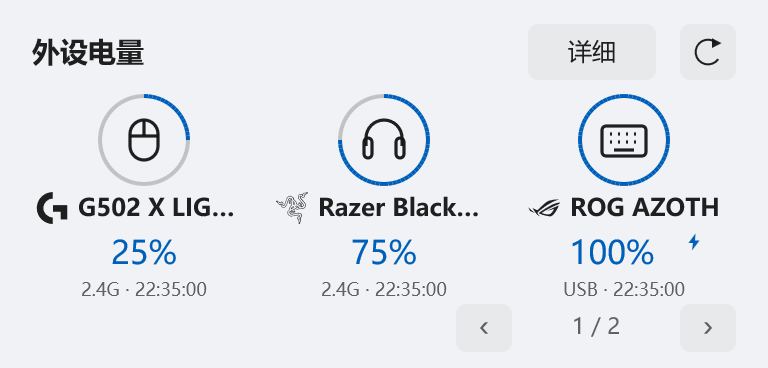
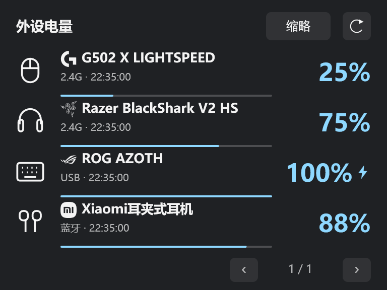

# 外设电量与更新兼容

现在可以在任务栏和快捷卡片中查看鼠标、键盘、耳机及手柄的电量。

## 外设电量

- 新增一张外设电量汇总卡，提供详细／缩略两种样式、手动分页和品牌标志；翻页及样式切换支持平滑过渡。
- 在“快捷卡片 → 外设电量”逐台选择显示设备、调整顺序和设置断连隐藏。任务栏电量模块独立配置，支持现有的单／双行布局、标签和颜色。
- 显示充电状态、连接方式与最近成功读取时间。刷新失败保留上次读数；左右耳和充电盒分别显示，未知电量不会变成 0%。
- 按显示需求采集，隐藏卡片不播放电量动画。

## 识别与交互修复

- 修复 Windows 蓝牙电量采集，以及 Razer BlackShark V2 HS 和 Logitech G502 X 的读取；罗技鼠标显示设备返回的实际型号。
- 修复 ROG 夜魔有线／接收器的连接识别，身份一致时合并为一台设备。
- 过滤无电量读取能力的普通 HID 项，减少无用列表条目。
- 修正耳罩式耳机图标，点击设备读数不再触发“不支持的卡片操作”。

## 卡片效果

<table>
  <tr><th>缩略模式 · 浅色</th><th>详细模式 · 深色</th></tr>
  <tr>
    <td valign="top"></td>
    <td valign="top"></td>
  </tr>
</table>

原生卡片渲染示例，使用示例数据；实际 Mica 背景随桌面与主题变化。具体型号和连接方式的支持情况见[外设电量说明](https://github.com/NoctisWang528/TaskBarWidget/blob/261110-2230/TaskBarWidgets/docs/外设电量.md)。

## 更新与下载

修复旧版更新器升级到新增外设组件时的兼容问题，继续支持本地传包；更新保留原有配置和历史。

- **首次安装／手动升级**：[下载 portable 包](https://github.com/NoctisWang528/TaskBarWidget/releases/download/261110-2230/TaskBarWidgets-261110-2230-win-x64-portable.zip)，完整解压后运行根目录的 `TaskBarWidgets.exe`。
- **已安装用户**：在“设置 → 关于”检查更新。不带 `-portable` 的 ZIP 用于应用内更新和本地推包，不用于手动解压启动。

此前的 `261110-1631` 已撤回，请更新到此版本。
