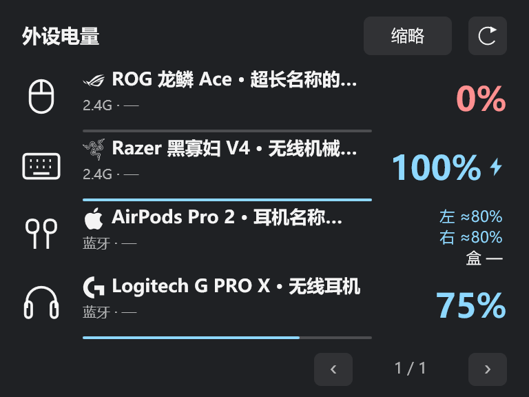

# AirPods 电量与卡片体验改进

- 新增 AirPods 免驱电量估算，左右耳和充电盒分别显示，支持 Apple 品牌标志。可在“设置 → 快捷卡片 → 外设电量”关闭广播读取。
- 修复 Razer BlackShark V2 HS 关机但接收器仍插着时不能自动隐藏的问题。开启“卡片隐藏已断开的设备”后，关机隐藏、开机恢复；临时读取失败仍保留上次电量。
- 详细卡片将多电池设备的读数放在右侧，移除该行底部电量条，左侧保留名称、连接方式和读取时间。
- 详细和缩略卡片的长名称支持横向往返滚动，品牌标志固定；卡片隐藏时停止，减少动画和高对比度模式下使用静态省略。

AirPods 广播电量约 10% 一档，以 `≈` 标记，并非精确百分比。已实测 AirPods Pro 2 USB-C；附近同型号设备可能影响匹配，未知分量显示“—”，打开盒盖有助于读取充电盒电量。

原生卡片渲染示例，使用示例数据；实际 Mica 背景随桌面与主题变化。

- **首次安装／手动升级**：[下载 portable 包](https://github.com/NoctisWang528/TaskBarWidget/releases/download/261111-0820/TaskBarWidgets-261111-0820-win-x64-portable.zip)，完整解压后运行根目录的 `TaskBarWidgets.exe`。
- **已安装用户**：在“设置 → 关于”检查更新。不带 `-portable` 的 ZIP 用于应用内更新和本地推包，不用于手动解压启动。更新保留现有配置和历史。
